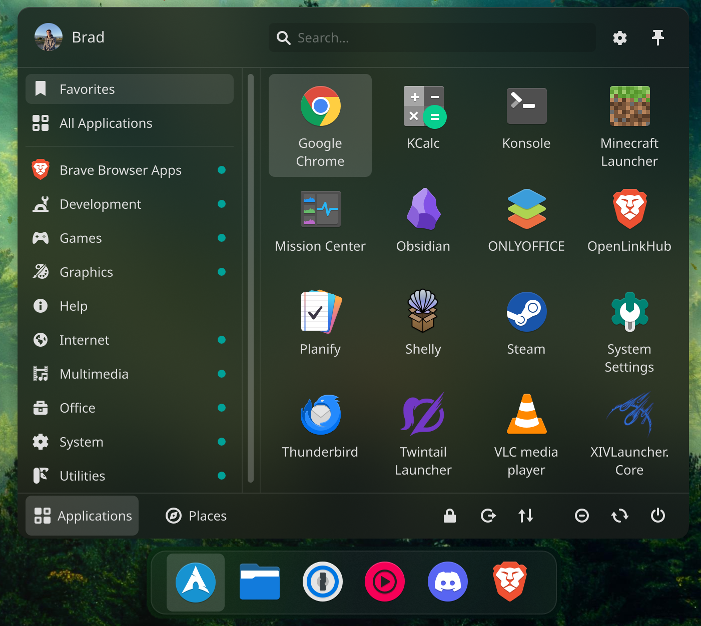

# Time
```
timedatectl set-local-rtc 1
```

# Bootloader Configuration
See - [secureboot-tpm2-uki-pcr.md](https://github.com/badams700/linux-setup/blob/main/secureboot-uki-tpm2-pcr.md)

# Applications
## Cider Repo
```
curl -s https://repo.cider.sh/ARCH-GPG-KEY | sudo pacman-key --add -
sudo pacman-key --lsign-key A0CD6B993438E22634450CDD2A236C3F42A61682
echo '[cidercollective]' | sudo tee -a /etc/pacman.conf
echo 'SigLevel = Required TrustedOnly' | sudo tee -a /etc/pacman.conf
echo 'Server = https://repo.cider.sh/arch' | sudo tee -a /etc/pacman.conf
sudo pacman -Syu
```
## Virtual Machine Manager
```
sudo pacman -S --needed --noconfirm qemu-full virt-manager swtpm
echo 'firewall_backend = "iptables"' | sudo tee -a /etc/libvirt/network.conf
sudo usermod -aG libvirt $USER
systemctl enable --now libvirtd.service
systemctl enable --now libvirtd.socket
sudo virsh net-autostart default
sudo ufw route allow from 192.168.122.0/24
```
## Yay
```
cd ~/Projects
git clone https://aur.archlinux.org/yay.git
cd yay
makepkg -si
```
## Install packages
```
yay -S --needed 1password bazaar blender bup calibre cava cider cmake darkly discord dolphin-plugins dysk extra-cmake-modules ffmpeg flatpak gimp git go handbrake jre-openjdk kup kwin-effects-better-blur-dx npm ntfs-3g ntfsprogs obs-studio-browser obsidian okular openoffice-bin openrgb prismlauncher protonplus proton-vpn-gtk-app qbittorrent rpi-imager terminus-font thunderbird ttf-noto-nerd twintaillauncher-bin visual-studio-code-bin vlc vulkan-devel vulkan-tools xivlauncher zoom
```
## Flatpak
```
flatpak install flathub io.github.maniacx.BudsLink io.github.wartybix.Constrict com.github.huluti.Curtail com.github.tchx84.Flatseal com.github.tenderowl.frog it.mijorus.gearlever com.makemkv.MakeMKV io.github.alainm23.planify org.vinegarhq.Sober app.zen_browser.zen
```
## Wallpaper Engine
```
sudo pacman -S --needed gst-plugin-pipewire gst-libav gst-plugins-bad-libs gst-plugins-good qt6-declarative qt6-websockets qt6-webchannel plasma-desktop libplasma vulkan-icd-loader lz4
```
```
cd ~/Projects
sudo wget https://raw.githubusercontent.com/badams700/linux-setup/main/Files/WallpaperEngine_kde6-1_1k-1-x86_64.pkg.tar.zst
sudo pacman -U ./WallpaperEngine_kde6-1_1k-1-x86_64.pkg.tar.zst --overwrite '*'
```
# Customization
## Klassy
```
sudo pacman -S --needed git frameworkintegration gcc-libs glibc kcmutils kcolorscheme kconfig kcoreaddons kdecoration kguiaddons ki18n kiconthemes kwidgetsaddons kwindowsystem qt6-base qt6-declarative qt6-svg xdg-utils extra-cmake-modules kcmutils5 frameworkintegration5 kconfigwidgets5 kiconthemes5 kwindowsystem5
```
```
cd ~/Projects
git clone https://github.com/paulmcauley/klassy
cd klassy
git checkout plasma6.6
./install.sh
```
## Orchis Theme
```
cd ~/Projects
git clone https://github.com/badams700/Orchis-kde
cd Orchis-kde/
./install.sh
```
## Window Blur
```
cd ~/Projects
sudo wget https://raw.githubusercontent.com/badams700/linux-setup/main/Files/blur.kwinrule
```
## Fastfetch
```
mkdir ~/.config/fastfetch
wget -P ~/.config/fastfetch https://raw.githubusercontent.com/badams700/linux-setup/main/Files/config.jsonc
```
## TTY Font
```
echo 'FONT=ter-132b' | sudo tee -a /etc/vconsole.conf
```
## Install from KDE Widgets / Icons
- Kurve
- Panel Colorizer
- Plasmusic Toolbar
- KDE Control Station
- Simple Separator
- Papirus Icons
## KDE Layout


# Other
## Hardware Acceleration Scripts
```
sudo wget -P ~/.config https://raw.githubusercontent.com/badams700/linux-setup/main/Files/chrome-flags.conf
sudo wget -P ~/Desktop https://raw.githubusercontent.com/badams700/linux-setup/main/Files/steam_dev.cfg
```
