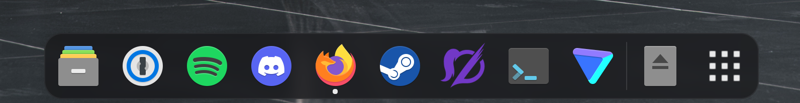

# Time
```
timedatectl set-local-rtc 1
```
# Snapshots
```
sudo pacman -S snapper snap-pac btrfs-assistant
```
Configure and take a base snapshot.
# Bootloader Configuration
<details>
<summary>Measured UKI - Direct Boot</summary>

## Install utilities 
```
sudo pacman -S sbctl systemd-ukify sbsigntools
```
## Edit mkinitcpio preset configuration
```
sudo nano /etc/mkinitcpio.d/linux-cachyos.preset
```
```
default_uki="/boot/EFI/Linux/cachyos.efi"
```
## Generate sbctl keys
```
sudo sbctl create-keys
```
## Generate PCR keys
```
sudo openssl genrsa -out /etc/systemd/tpm2-pcr-private-key.pem 2048
sudo openssl rsa -in /etc/systemd/tpm2-pcr-private-key.pem -pubout -out /etc/systemd/tpm2-pcr-public-key.pem
```
## Edit UKI configuration
```
sudo nano /etc/kernel/uki.conf
```
```
[UKI]
SecureBootSigningTool=sbsign
SecureBootPrivateKey=/var/lib/sbctl/keys/db/db.key
SecureBootCertificate=/var/lib/sbctl/keys/db/db.pem

[PCRSignature:all]
PCRPrivateKey=/etc/systemd/tpm2-pcr-private-key.pem
PCRPublicKey=/etc/systemd/tpm2-pcr-public-key.pem
```
## Disable sbctl hooks
```
sudo ln -sf /dev/null /etc/kernel/install.d/91-sbctl.install
sudo ln -sf /dev/null /usr/lib/kernel/install.d/91-sbctl.install
sudo ln -sf /dev/null /etc/pacman.d/hooks/zz-sbctl.hook
sudo ln -sf /dev/null /etc/initcpio/post/sbctl
```
## Enroll sbctl keys to UEFI
```
sudo sbctl enroll-keys -m
```
## Regenerate signed UKI
```
sudo mkinitcpio -P
```
## Add UKI to UEFI boot menu
```
sudo efibootmgr \
  --create \
  --disk /dev/nvme_n_ \
  --part _ \
  --label "CachyOS" \
  --loader /EFI/Linux/cachyos.efi \
  --unicode
```
## Reboot to firmware and enable Secure Boot - ensure UKI shows up in boot menu
```
systemctl reboot --firmware-setup
```
## Enroll TPM to LUKS
```
sudo systemd-cryptenroll /dev/nvme_n_p_ \
  --tpm2-device=auto \
  --tpm2-pcrs=0+2+7+12 \
  --tpm2-public-key=/etc/systemd/tpm2-pcr-public-key.pem
```
## Remove systemd-boot if successful
```
sudo bootctl remove
```
</details>

# Applications
## Cider Repo
```
curl -s https://repo.cider.sh/ARCH-GPG-KEY | sudo pacman-key --add -
sudo pacman-key --lsign-key A0CD6B993438E22634450CDD2A236C3F42A61682
echo '[cidercollective]' | sudo tee -a /etc/pacman.conf
echo 'SigLevel = Required TrustedOnly' | sudo tee -a /etc/pacman.conf
echo 'Server = https://repo.cider.sh/arch' | sudo tee -a /etc/pacman.conf
sudo pacman -Syu
```
## Virtual Machine Manager
```
sudo pacman -S --needed --noconfirm qemu-full virt-manager swtpm
echo 'firewall_backend = "iptables"' | sudo tee -a /etc/libvirt/network.conf
sudo usermod -aG libvirt $USER
systemctl enable --now libvirtd.service
systemctl enable --now libvirtd.socket
sudo virsh net-autostart default
sudo ufw route allow from 192.168.122.0/24
```
## Yay
```
cd ~/Projects
git clone https://aur.archlinux.org/yay.git
cd yay
makepkg -si
```
## Install packages - GNOME or KDE
```
yay -S --needed 1password bazaar blender calibre cava cmake discord dysk extra-cmake-modules ffmpeg flatpak gimp git go handbrake jre-openjdk npm ntfs-3g ntfsprogs obs-studio-browser obsidian onlyoffice-bin openrgb prismlauncher protonplus proton-vpn-gtk-app qbittorrent rpi-imager terminus-font thunderbird ttf-noto-nerd twintaillauncher-bin visual-studio-code-bin vlc xivlauncher zoom && flatpak install flathub io.github.maniacx.BudsLink io.github.wartybix.Constrict com.github.huluti.Curtail com.github.tchx84.Flatseal com.github.tenderowl.frog it.mijorus.gearlever com.makemkv.MakeMKV io.github.alainm23.planify org.vinegarhq.Sober app.zen_browser.zen com.rafaelmardojai.Blanket
```
## Hardware Acceleration Scripts
```
sudo wget -P ~/.config https://raw.githubusercontent.com/badams700/linux-setup/main/Files/chrome-flags.conf
sudo wget -P ~/Desktop https://raw.githubusercontent.com/badams700/linux-setup/main/Files/steam_dev.cfg
```
## Fastfetch
```
mkdir ~/.config/fastfetch
wget -P ~/.config/fastfetch https://raw.githubusercontent.com/badams700/linux-setup/main/Files/config.jsonc
```
## TTY Font
```
echo 'FONT=ter-132b' | sudo tee -a /etc/vconsole.conf
```
<details>
<summary>KDE Customizations</summary>

## KDE Applications
```
yay -S --needed bup darkly dolphin-plugins kup kwin-effects-better-blur-dx okular plasma6-applets-audio-visualizer plasma6-applets-panel-colorizer
```
## Wallpaper Engine
```
sudo pacman -S --needed gst-plugin-pipewire gst-libav gst-plugins-bad-libs gst-plugins-good qt6-declarative qt6-websockets qt6-webchannel plasma-desktop libplasma vulkan-icd-loader lz4
```
```
cd ~/Projects
sudo wget https://raw.githubusercontent.com/badams700/linux-setup/main/Files/WallpaperEngine_kde6-1_1k-1-x86_64.pkg.tar.zst
sudo pacman -U ./WallpaperEngine_kde6-1_1k-1-x86_64.pkg.tar.zst --overwrite '*'
```
## Klassy
```
sudo pacman -S --needed git frameworkintegration gcc-libs glibc kcmutils kcolorscheme kconfig kcoreaddons kdecoration kguiaddons ki18n kiconthemes kwidgetsaddons kwindowsystem qt6-base qt6-declarative qt6-svg xdg-utils extra-cmake-modules kcmutils5 frameworkintegration5 kconfigwidgets5 kiconthemes5 kwindowsystem5
```
```
cd ~/Projects
git clone https://github.com/paulmcauley/klassy
cd klassy
git checkout plasma6.6
./install.sh
```
## Orchis Theme
```
cd ~/Projects
git clone https://github.com/badams700/Orchis-kde
cd Orchis-kde/
./install.sh
```
## Window Blur
```
cd ~/Projects
sudo wget https://raw.githubusercontent.com/badams700/linux-setup/main/Files/blur.kwinrule
```
## Install from KDE Widgets / Icons
- Plasmusic Toolbar
- KDE Control Station
- Simple Separator

## Papirus Icons
```
wget -qO- https://git.io/papirus-icon-theme-install | sh
```
```
wget -qO- https://git.io/papirus-folders-install | sh
```
```
papirus-folders -C palebrown --theme Papirus-Dark
```

## KDE Layout

</details>

<details>
<summary>GNOME Customizations</summary>
  
## GNOME Extensions
- App Hider
- Better Tray Icons
- Blur My Shell
- Caffeine
- Dash to Dock
- GSConnect
- Hide System Icons
- Just Perfectionn
- Multi Display Adjustment
## Yay
```
yay -S ddcutil-service alacarte
## Flatpak
```
flatpak install flathub com.mattjakeman.ExtensionManager io.github.realmazharhussain.GdmSettings io.gitlab.adhami3310.Impression org.gnome.World.PikaBackup
```
## Papirus Icons
```
wget -qO- https://git.io/papirus-icon-theme-install | sh
```
```
wget -qO- https://git.io/papirus-folders-install | sh
```
```
papirus-folders -C palebrown --theme Papirus-Dark
```
Adjust Icons in GNOME Tweaks.
## Cursor
Capitaine Cursor: https://www.gnome-look.org/p/1148692
```
cd ~/Projects
tar xf capitaine-cursors-r4.tar.gz
sudo cp -r capitaine-cursors ~/.local/share/icons
```
Set cursor in GNOME Tweaks.
## GNOME Layout

</details>


